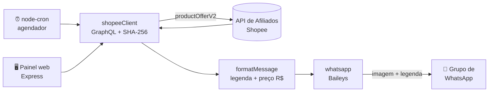

<div align="center">

# 🛍️ Robô Shopee — Achadinhos no WhatsApp

**Automação que busca as melhores ofertas na API de Afiliados da Shopee e publica todo dia, sozinha, em um grupo de WhatsApp — com link de afiliado, imagem do produto e legenda pronta para vender.**


</div>

---

## 📌 Sobre o projeto

Quem trabalha com marketing de afiliados passa horas procurando produtos, copiando links, baixando imagens e escrevendo legendas. Este robô faz tudo isso automaticamente:

1. **Consulta** a API GraphQL de Afiliados da Shopee, com autenticação por assinatura SHA-256;
2. **Seleciona** os produtos mais vendidos (opcionalmente filtrados por palavra-chave);
3. **Monta** uma legenda com título, chamada, preço formatado em R$ e link de afiliado;
4. **Envia** cada oferta com a foto do produto para o grupo de WhatsApp, no horário agendado.

Também tem um **painel web** onde dá para revisar e editar as ofertas antes de mandar, para quem prefere ter controle manual.

## ✨ Funcionalidades

| | Funcionalidade | Detalhe |
|---|---|---|
| ⏰ | **Envio agendado** | Expressão cron configurável, no fuso `America/Sao_Paulo` |
| 🔐 | **Integração autenticada** | Cliente GraphQL com header `SHA256 Credential/Timestamp/Signature` exigido pela Shopee |
| 🖼️ | **Mensagens com imagem** | Cada oferta vai como foto + legenda formatada em Markdown do WhatsApp |
| 🖥️ | **Painel web** | Buscar, editar legenda, desmarcar e enviar as ofertas em lote pelo navegador |
| 🔄 | **Reconexão resiliente** | Reconecta sozinho quando o WhatsApp cai, sem duplicar o agendamento |
| ⏱️ | **Envio espaçado** | Intervalo entre mensagens para evitar bloqueio por spam |
| 🧪 | **Modo de teste** | Mostra no terminal como ficariam as mensagens, sem enviar nada |
| 🚀 | **Pronto para produção** | Roda 24/7 em VPS com PM2 |

## 🏗️ Arquitetura



### Estrutura de pastas

```
├── index.js               # Robô principal: conecta no WhatsApp e agenda o envio diário
├── public/                # Front-end do painel (HTML, CSS e JS puro)
└── src/
    ├── config.js          # Leitura e validação das variáveis de ambiente
    ├── shopeeClient.js    # Cliente GraphQL da Shopee com assinatura SHA-256
    ├── formatMessage.js   # Gera legendas de afiliado e formata preços em BRL
    ├── whatsapp.js        # Conexão via Baileys, QR code, reconexão e envio
    ├── webServer.js       # API REST (Express) que alimenta o painel
    ├── sendNow.js         # Envio imediato, sem esperar o agendamento
    ├── whatsappLogin.js   # Login por QR code
    ├── listGroups.js      # Lista os grupos da conta e seus IDs
    └── testShopee.js      # Testa a API sem enviar nada
```

## 🛠️ Tecnologias

- **Node.js** (ES Modules, `fetch` nativo, `crypto`)
- **[Baileys](https://github.com/WhiskeySockets/Baileys)**: cliente WhatsApp Web via WebSocket
- **Express**: API REST do painel
- **node-cron**: agendamento das publicações
- **GraphQL**: consumo da Shopee Affiliate Open API
- **pino** e **dotenv**: logs e configuração
- **PM2**: gerenciamento do processo em produção

## 🚀 Como rodar (em qualquer máquina)

Este passo a passo serve para instalar do zero em um computador ou servidor novo.

### Pré-requisitos

- **Node.js 18 ou superior** ([nodejs.org](https://nodejs.org/)); confira com `node -v`
- **Git**
- **App ID e App Secret** da [Shopee Affiliate Open Platform](https://open-api.affiliate.shopee.com.br/)
- **Celular com o WhatsApp** da conta que vai enviar as mensagens. Essa conta precisa estar no grupo de destino.

### 1. Baixar o projeto e instalar as dependências

```bash
git clone https://github.com/calazans17/Robo-Shopee.git
cd Robo-Shopee
npm install
```

### 2. Colocar a chave da Shopee 🔑

As credenciais ficam no arquivo **`.env`** na raiz do projeto. Ele nunca vai para o GitHub, então é preciso criá-lo em cada máquina:

```bash
cp .env.example .env        # Linux / macOS / WSL
copy .env.example .env      # Windows (cmd)
```

Abra o `.env` em qualquer editor e preencha:

```env
SHOPEE_APP_ID=seu_app_id_aqui
SHOPEE_APP_SECRET=seu_app_secret_aqui
```

> **Onde pegar:** entre no painel de afiliado da Shopee Open Platform e abra **Open API**. O **App ID** e o **App Secret** estão lá. Não compartilhe o Secret com ninguém.

Teste se a chave está funcionando (nada é enviado ao WhatsApp):

```bash
npm run test-shopee
```

Se aparecer a lista de ofertas no terminal, a integração com a Shopee está ok.

### 3. Vincular o WhatsApp pelo QR code 📱

```bash
npm run login
```

1. Um **QR code** aparece no terminal.
2. No celular, abra o WhatsApp e vá em **⋮ / Configurações › Aparelhos conectados › Conectar um aparelho**.
3. Escaneie o QR code da tela.
4. O terminal mostra `Login concluido!`. Aperte `Ctrl + C` para sair.

A sessão fica salva na pasta `auth_baileys/`. Enquanto o aparelho não for desconectado pelo celular, **não é preciso escanear de novo**.

> 💡 Se o QR expirar antes de você escanear, ele é gerado de novo automaticamente. Se o terminal deixar o QR quebrado, aumente a janela ou diminua a fonte.

### 4. Escolher o grupo

```bash
npm run list-groups
```

O comando lista todos os grupos da conta:

```
- Achadinhos da Shopee  =>  120363000000000000@g.us
```

Copie o ID (o texto terminado em `@g.us`) para o `.env`:

```env
WHATSAPP_GROUP_ID=120363000000000000@g.us
```

### 5. Ajustar horário e quantidade (opcional)

| Variável | Descrição | Padrão |
|---|---|---|
| `SCHEDULE_CRON` | Horário do envio diário, em formato cron, no horário de Brasília | `0 9 * * *` (todo dia às 9h) |
| `OFFERS_PER_DAY` | Quantas ofertas mandar por envio | `5` |
| `SHOPEE_KEYWORD` | Busca só produtos de um tema. Vazio busca os mais vendidos em geral | *(vazio)* |
| `SHOPEE_API_URL` | Endpoint GraphQL da Shopee Brasil | `https://open-api.affiliate.shopee.com.br/graphql` |

Exemplos de cron: `0 9 * * *` envia às 9h · `30 12 * * *` envia às 12h30 · `0 9,18 * * *` envia às 9h e às 18h.

### 6. Rodar

```bash
npm start                # robô automático: fica ligado e envia no horário do SCHEDULE_CRON
npm run send-now         # envia as ofertas para o grupo agora mesmo e encerra
npm run web              # painel para revisar e editar antes de enviar (http://localhost:3000)
npm run test-shopee      # só mostra as ofertas no terminal, sem enviar
```

### Resumo rápido

```bash
git clone https://github.com/calazans17/Robo-Shopee.git && cd Robo-Shopee
npm install
cp .env.example .env     # preencha SHOPEE_APP_ID e SHOPEE_APP_SECRET
npm run test-shopee      # valida a chave da Shopee
npm run login            # escaneia o QR code com o WhatsApp
npm run list-groups      # copia o ID do grupo para WHATSAPP_GROUP_ID no .env
npm start                # pronto 🚀
```

### Trocando de máquina

- **Jeito mais simples:** faça os passos 2 a 4 de novo na máquina nova, escaneando um QR novo.
- **Sem escanear de novo:** copie o `.env` e a pasta `auth_baileys/` da máquina antiga para a nova.
- ⚠️ **Não rode o robô em duas máquinas ao mesmo tempo com a mesma sessão.** O WhatsApp derruba uma das conexões e o grupo pode receber as ofertas em dobro.
- Se aparecer `Sessao deslogada`, apague a pasta `auth_baileys/` e rode `npm run login` de novo.

## 🖥️ Painel web

Em `http://localhost:3000` o painel:

- mostra se o WhatsApp está conectado e para qual grupo vai o envio;
- busca as ofertas da Shopee na quantidade escolhida;
- deixa **editar a legenda** de cada oferta e **desmarcar** as que não interessam;
- envia todas as selecionadas de uma vez, com o mesmo intervalo do robô automático.

## ☁️ Rodando 24/7 em produção

```bash
npm install -g pm2
pm2 start index.js --name robo-shopee
pm2 save
pm2 startup
```

O robô continua rodando mesmo depois que o servidor reinicia.

## 💡 Desafios técnicos resolvidos

- **Autenticação da Shopee:** a API exige uma assinatura `SHA256(AppId + Timestamp + Payload + Secret)` gerada a cada requisição. Ela foi implementada com o módulo nativo `crypto`, sem depender de SDK.
- **Agendamento duplicado:** o evento de "conexão pronta" do WhatsApp dispara de novo a cada reconexão. O robô guarda sempre o socket mais recente e registra o cron uma única vez, então o grupo nunca recebe a mesma oferta repetida.
- **Conexão instável logo após conectar:** os envios só começam depois de uma janela de estabilização, e um contador de "geração" descarta conexões antigas.
- **Envio em grupos:** a API oficial do WhatsApp Business não envia mensagens para grupos, por isso o projeto usa o protocolo do WhatsApp Web via Baileys.

## ⚠️ Aviso

Este é um projeto pessoal e educacional. O envio usa o WhatsApp Web de forma não oficial, então use com moderação e respeite os termos de uso do WhatsApp e da Shopee. Credenciais (`.env`) e a sessão do WhatsApp (`auth_baileys/`) ficam fora do repositório.

---

<div align="center">

Desenvolvido por **[Pedro Augusto Alves Oliveira Calazans](https://github.com/calazans17)**

</div>
